<p align="center">
  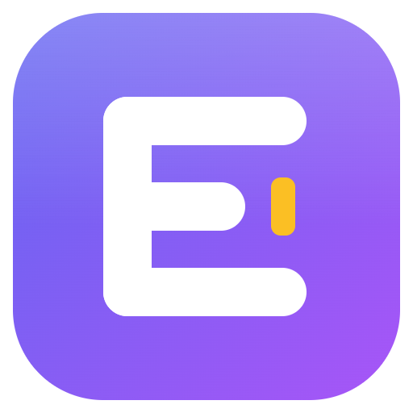
</p>

<h1 align="center">Easey IDE</h1>

<p align="center">
  <strong>L'IDE per imparare a programmare:</strong> HTML, CSS, JavaScript, TypeScript, Python e SQL,<br>
  con progettazione visuale, programmazione a blocchi, diagrammi, esercizi verificati e AI locale.
</p>

<p align="center">
  <a href="LICENSE"></a>
  
  
  
</p>

<p align="center"><em>Ideato e realizzato interamente da <strong>Daniele Gabrovec</strong>.</em></p>

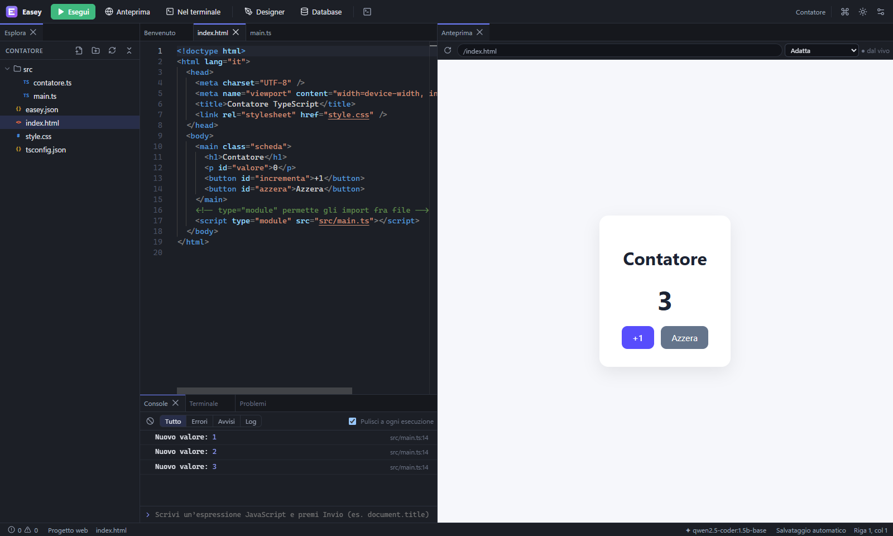

**Scrivi il codice a sinistra, premi Esegui (F5) e lo vedi funzionare a destra.** Easey IDE mette in
un'unica app per Windows tutto quello che serve a chi impara lo sviluppo web e i database: un editor
professionale, l'anteprima dal vivo, il terminale, un database vero, un designer grafico stile
Canva/Wix, la programmazione a blocchi, i diagrammi, le lezioni con esercizi che si correggono da soli
e un assistente AI che **gira interamente sul tuo PC**. Per provare un'idea al volo c'è la **Scrittura
rapida**: JavaScript, TypeScript, Python, SQL o HTML senza creare un progetto.

---

## Indice

- [Cosa sa fare](#cosa-sa-fare)
- [Installazione](#installazione)
- [Primi passi](#primi-passi)
- [L'assistente AI locale](#lassistente-ai-locale)
- [Come funziona dentro](#come-funziona-dentro)
- [Sviluppo dal codice sorgente](#sviluppo-dal-codice-sorgente)
- [Note legali, privacy e licenza](#note-legali-privacy-e-licenza)
- [English summary](#english-summary)

---

## Cosa sa fare

### Scrivere ed eseguire codice
- **Editor Monaco** (lo stesso motore di Visual Studio Code) con completamento intelligente per
  HTML, CSS, JavaScript e TypeScript, segnalazione degli errori, formattazione, salvataggio automatico
  e **cronologia locale** di ogni file (torni a una versione precedente in un clic).
- **Anteprima web dal vivo**: TypeScript compilato al volo, errori e `console.log` riportati **sulla
  riga del file originale**, simulazione di telefono e tablet.
- **Terminale integrato** (PowerShell, cmd, Git Bash) ed **Esegui nel terminale** (Ctrl+F5) per i
  programmi console con input da tastiera.

### Scrittura rapida, senza progetto (novità 1.1)
Per provare un'idea al volo: **Ctrl+Shift+Q** (o *Scrittura rapida* nel Benvenuto e nella barra in alto)
apre un foglio a tutta finestra **senza creare né aprire un progetto**.
- **JavaScript, TypeScript, Python, SQL e HTML** (con CSS e JavaScript dentro la pagina). Python è
  incluso nell'app (Pyodide, CPython 3.14 in WebAssembly): **non serve installarlo** e funziona offline.
- **Risultato subito**: il codice si esegue da solo dopo una breve pausa nella scrittura (o con
  Ctrl+Invio / F5). Il valore di ogni espressione e variabile e ciò che stampi compaiono **accanto
  alla riga** che li ha prodotti, gli errori sono segnati sulla riga giusta (anche in TypeScript).
- **Al sicuro dagli errori**: ogni esecuzione gira in un processo separato con un tempo massimo, quindi
  un ciclo infinito viene fermato e l'IDE resta reattivo.
- **SQL** su un database in memoria (SQLite o PostgreSQL), con dati d'esempio e l'opzione *database pulito
  a ogni esecuzione*; **HTML** con anteprima viva e console della pagina.
- **Aiuto a livelli** mentre scrivi: *Spento*, *Leggero* (suggerimenti e completamento AI di una riga),
  *Intermedio* (modelli rapidi e qualche riga), *Forte* (blocchi interi, anche a metà riga). Con
  **Ctrl+I** descrivi a parole cosa vuoi e l'AI scrive il codice, che viene subito eseguito.
- **Raccolta**: Ctrl+S salva in `Documenti\Easey IDE\Scrittura rapida` come file normali (`.js`, `.ts`,
  `.py`, `.sql`, `.html`); la bozza in corso si ritrova anche dopo aver chiuso l'app.

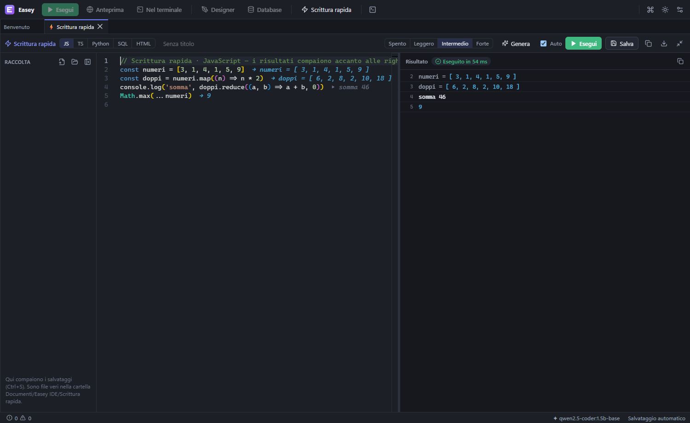

| Python senza installazioni | HTML con anteprima viva |
|---|---|
| 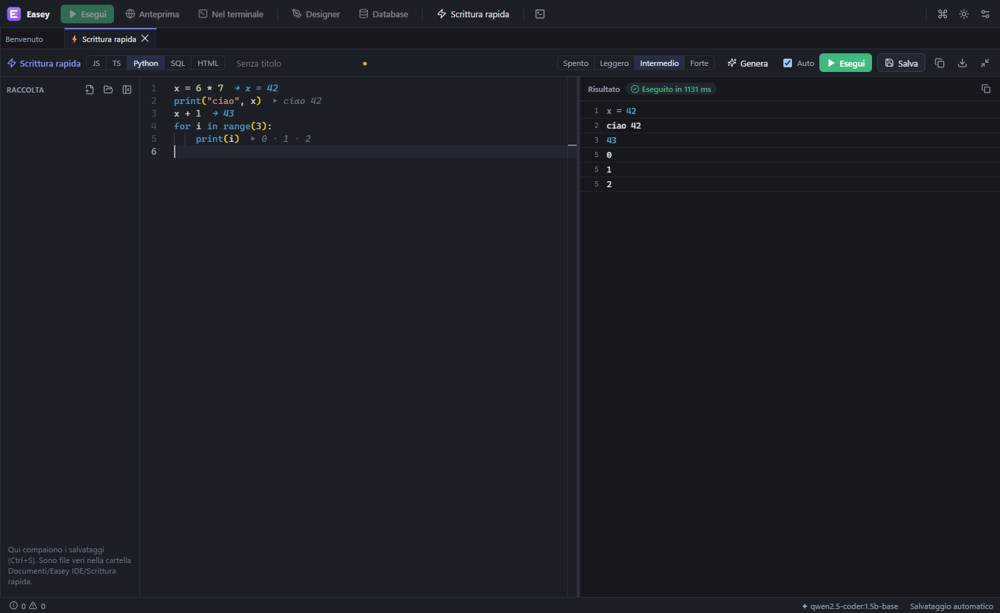 | 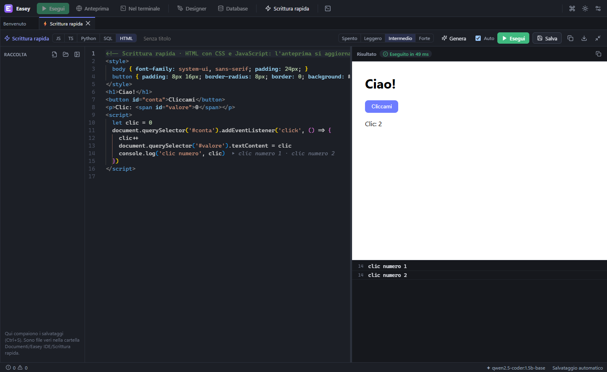 |

### Passo passo, come «Python Tutor»
Esegui un programma **una riga alla volta**, avanti e indietro: la riga corrente è evidenziata
nell'editor, a destra vedi le chiamate di funzione in corso e il valore di ogni variabile (quelle
appena cambiate si illuminano). Il modo migliore per capire cicli e funzioni.

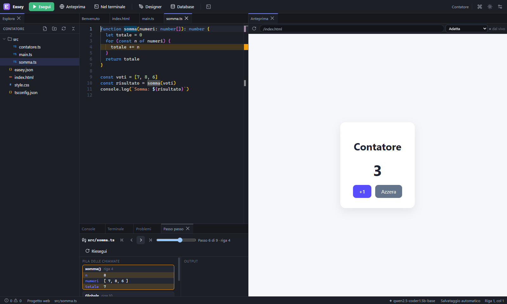

### Designer visuale stile Canva/Wix
Costruisci la pagina **trascinando** titoli, pulsanti, immagini, moduli e sezioni pronte; scegli
colori e caratteri da un pannello. Il codice HTML/CSS si aggiorna **solo dove serve** (il tuo codice
non viene riformattato) e, se modifichi il codice, il disegno si aggiorna.

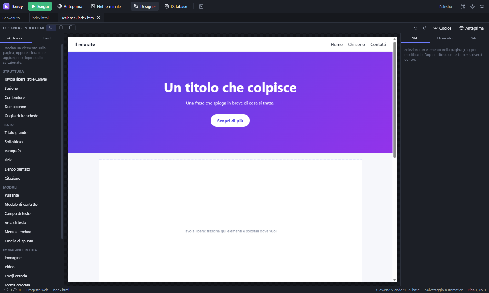

### SQL Lab: database veri
**SQLite** e **PostgreSQL** incorporato (nessuna installazione), database d'esempio, query con
Ctrl+Invio, risultati esportabili, terminale SQL, designer di tabelle, **diagramma ER**, costruttore
visuale di query, piano di esecuzione spiegato, istantanee per sperimentare senza paura e query
scritte dall'AI a partire da una descrizione in italiano.

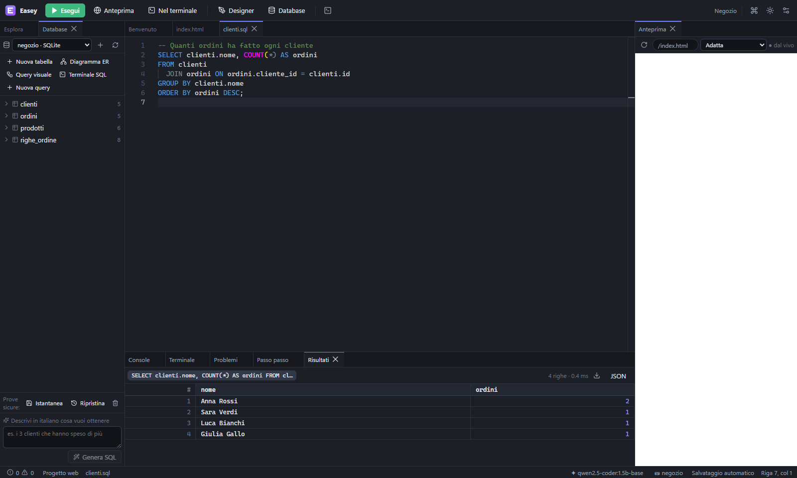

<details>
<summary>Diagramma ER generato dal database</summary>

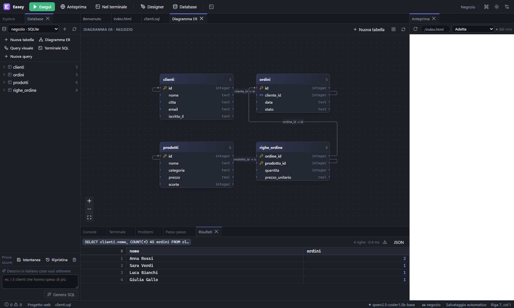
</details>

### Programmazione visuale e diagrammi
- **Blocchi a incastro** (Blockly) e **nodi collegati** che agiscono sugli elementi reali della
  pagina, con il codice JavaScript generato accanto e il blocco in esecuzione evidenziato.
- **Diagrammi con connettori**: un diagramma di flusso diventa codice che si esegue, e da una funzione
  si ottiene il suo diagramma; lo schema di un database diventa `CREATE TABLE`, un diagramma UML
  diventa classi TypeScript; mappe mentali; esportazione SVG, PNG e Mermaid.

| Blocchi | Diagramma di flusso |
|---|---|
| 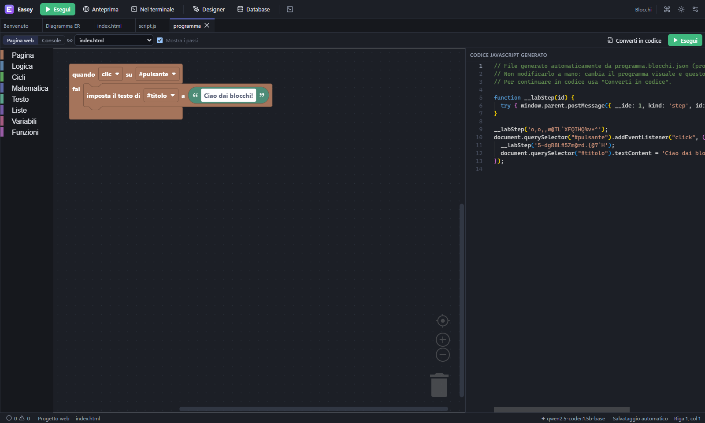 | 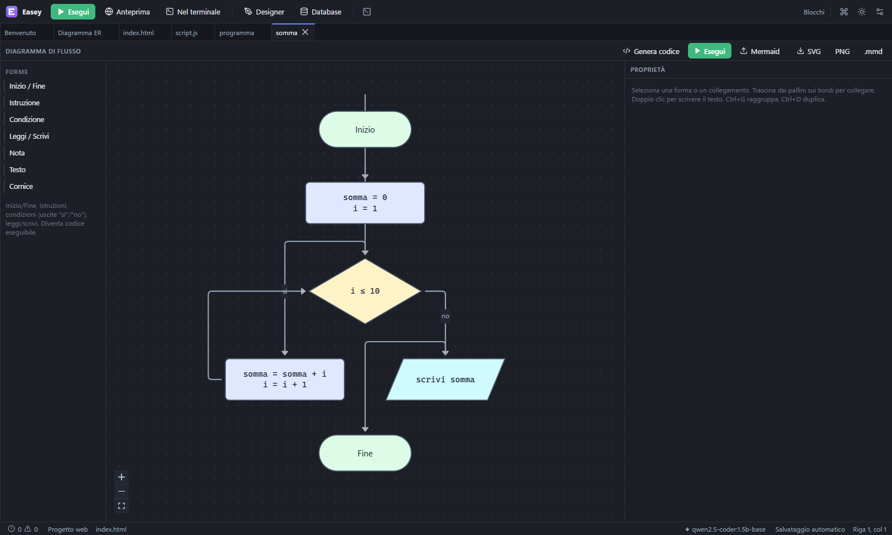 |

### Lezioni ed esercizi che si correggono da soli
Il pannello **Lezioni** (Ctrl+Alt+L) propone corsi con spiegazioni ed esercizi. Premi **Verifica**:
il programma controlla le tue funzioni con valori diversi, la struttura e gli **stili** della tua
pagina, o il risultato della tua query SQL, e ti dice esattamente cosa manca. Ci sono suggerimenti
graduati, la soluzione si sblocca dopo un tentativo, i progressi restano salvati e un **tutor AI**
ti dà un indizio alla volta senza rivelarti la soluzione.

I manuali della collana *«Imparare a programmare»* si importano con un clic: ogni capitolo diventa
una lezione e ogni esercizio 🧪 un compito. Come scrivere un corso: [docs/CORSI.md](docs/CORSI.md).

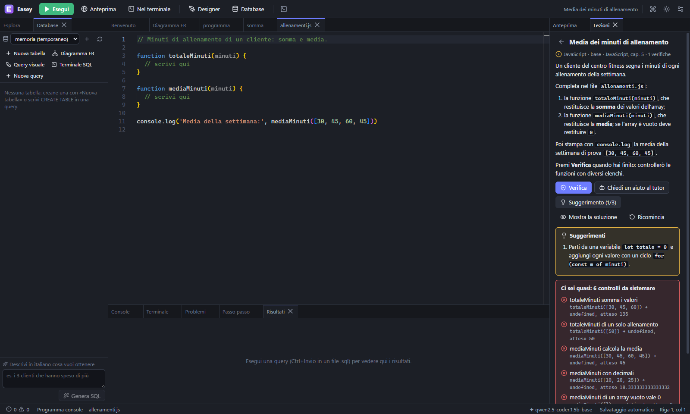

### Git, esportazione e tutto il resto
- **Git integrato** (Ctrl+Alt+G): crea il repository, vedi le modifiche affiancate, fai commit e
  consulta la cronologia.
- **Esporta** il progetto come ZIP o come **pagina HTML unica** (CSS, TypeScript e immagini dentro un
  solo file da aprire con doppio clic).
- Pannelli agganciabili, palette dei comandi (Ctrl+Shift+P), **Vai al file** (Ctrl+P), tema chiaro e
  scuro, interfaccia in italiano (inglese pronto).

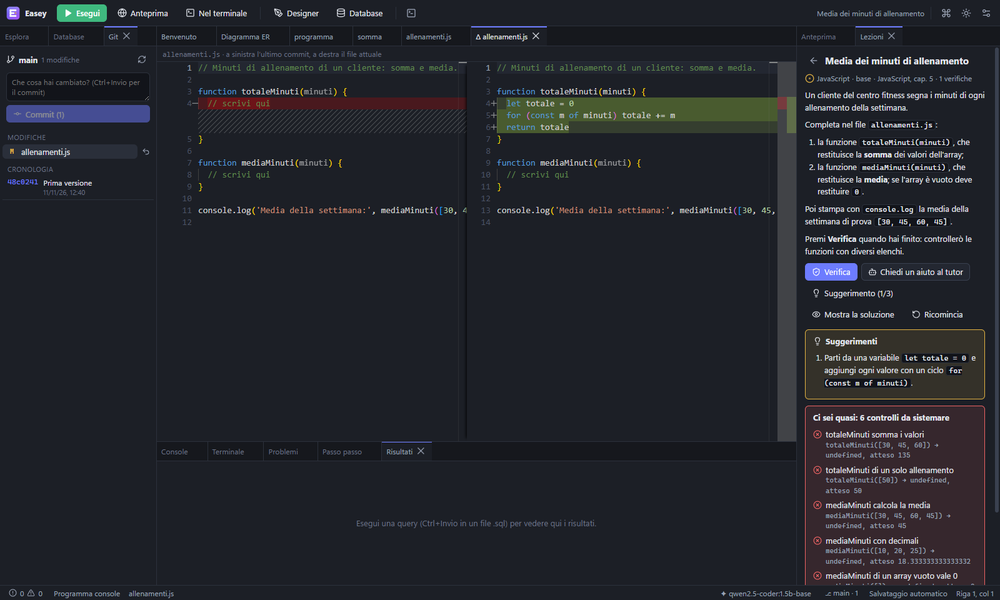

---

## Installazione

1. Scarica `Easey-IDE-Setup-1.0.0.exe` dalla pagina
   [Releases](https://github.com/danielegabrovec/easey-ide/releases).
2. Avvialo e scegli la cartella di installazione.
   L'installer non è firmato digitalmente: se Windows SmartScreen lo segnala, scegli
   *Ulteriori informazioni → Esegui comunque*.
3. *(Facoltativo, per l'AI)* installa [Ollama](https://ollama.com) oppure
   [LM Studio](https://lmstudio.ai) — vedi [L'assistente AI locale](#lassistente-ai-locale).
4. *(Facoltativo, per Git e per un terminale completo)* installa [Git](https://git-scm.com) e
   [Node.js](https://nodejs.org). Senza Node.js i programmi console girano comunque con il Node
   incluso nell'app.

**Requisiti:** Windows 10 o 11 a 64 bit, circa 450 MB di spazio. L'app usa circa 700 MB di RAM.

## Primi passi

1. **Nuovo progetto** (Ctrl+Shift+N) e scegli un modello: *Pagina web*, *Pagina web con TypeScript*,
   *Sito con il designer*, *Programma console* JS o TS.
2. Scrivi il codice e premi **F5**: la pagina compare a destra, i messaggi nella Console.
3. Prova il **Designer**, il **Database** (Ctrl+Shift+D) o le **Lezioni** (Ctrl+Alt+L).
4. Su un file JavaScript o TypeScript premi **Ctrl+F10** per eseguirlo passo passo.
5. Tasto destro nell'editor → **✦ Spiega questo codice** per chiedere all'AI.
6. Per una prova veloce senza progetto: **Ctrl+Shift+Q** (Scrittura rapida).

| Azione | Tasti |
|---|---|
| Esegui il progetto | F5 |
| Esegui il file nel terminale | Ctrl+F5 |
| Esegui passo passo | Ctrl+F10 |
| Palette dei comandi / Vai al file | Ctrl+Shift+P / Ctrl+P |
| Database / Designer | Ctrl+Shift+D / Ctrl+Shift+G |
| Lezioni / Git / Assistente AI | Ctrl+Alt+L / Ctrl+Alt+G / Ctrl+Shift+A |
| Verifica l'esercizio | F9 |
| Scrittura rapida · esegui · salva · genera con AI | Ctrl+Shift+Q · Ctrl+Invio · Ctrl+S · Ctrl+I |

---

## L'assistente AI locale

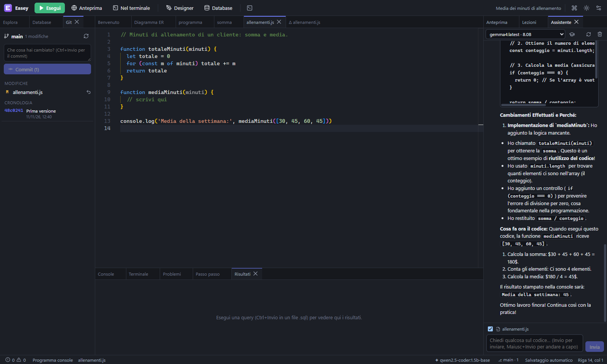

### Che cosa fa
| Funzione | Come si usa |
|---|---|
| Autocompletamento in linea | scrivi: il suggerimento grigio si accetta con **Tab** |
| Chat che conosce il tuo codice | Ctrl+Shift+A: file aperto, selezione ed errori vengono inviati come contesto |
| Azioni rapide | tasto destro: *Spiega*, *Perché questo errore?*, *Proponi una correzione* (con confronto prima/dopo), *Aggiungi commenti*, *Scrivi test* |
| SQL da descrizione | nel SQL Lab: «i clienti con più di 3 ordini» → query sulle tue tabelle reali, mostrata prima di eseguirla |
| Modalità tutor | l'AI guida con domande e indizi invece di dare la soluzione |
| Tutor degli esercizi | nelle Lezioni: un indizio alla volta, mai la soluzione intera |

### Come funziona
Easey IDE **non contiene un modello e non usa servizi online**: dialoga con un server di modelli che
gira sul tuo PC, chiamandolo dal processo principale dell'app.

```
Editor · Chat · SQL Lab · Lezioni ──► processo principale di Easey ──► server AI locale
                                                                        ├─ Ollama      http://127.0.0.1:11434
                                                                        └─ compatibile OpenAI (LM Studio, llama.cpp, vLLM)
                                                                                       http://127.0.0.1:1234/v1
```

- Le risposte arrivano **in streaming** e ogni richiesta si può interrompere.
- Easey sceglie da solo i modelli fra quelli installati: per l'**autocompletamento** il più piccolo
  che sa «riempire il mezzo» del codice (*fill-in-the-middle*), per la **chat** un modello
  generalista (preferenza: Gemma 4, gpt-oss, Qwen 3, Llama 3, Mistral). I modelli «cloud» non
  vengono mai scelti in automatico. Puoi fissarli tu in **Impostazioni → Assistente AI**.
- Se il server è spento l'IDE funziona normalmente; la barra di stato mostra «AI non disponibile» e
  ricontrolla da sola ogni 30 secondi.

### Configurazione in 2 minuti
**Con Ollama**
```bash
ollama pull qwen2.5-coder:1.5b-base
```
```bash
ollama pull gemma4
```
Il primo modello serve all'autocompletamento, il secondo alla chat. Easey li trova da solo.

**Con LM Studio:** scarica un modello, avvia il *server locale* di LM Studio, poi in Easey
**Impostazioni → Assistente AI → Fornitore: Compatibile OpenAI** e premi **Verifica**
(l'indirizzo predefinito `http://127.0.0.1:1234/v1` è già quello giusto).

### Quante risorse servono
I modelli restano in memoria 15 minuti dopo l'ultima richiesta, poi vengono liberati.

| PC | Modelli consigliati | Memoria occupata (indicativa) |
|---|---|---|
| Scheda video da 4 GB | qwen2.5-coder 1.5B + gemma4 | circa 1 GB + 3 GB |
| Scheda video da 8 GB | anche modelli da 14B (es. `qwen2.5-coder:14b`) | 8–9 GB |
| Scheda video da 16 GB | anche `gpt-oss:20b` o modelli da 26–30B | 13–17 GB |
| Senza scheda video dedicata | solo modelli piccoli (1,5–4B) sul processore | 1–3 GB di RAM; la chat diventa lenta |

> ⚠️ Le risposte dell'AI possono essere sbagliate: verifica sempre il codice proposto. Ogni modello ha
> la propria licenza d'uso (vedi le [note legali](NOTE-LEGALI.md)).

---

## Come funziona dentro

Easey IDE è un'app **Electron** scritta in **TypeScript** con **React**.

| Parte | Tecnologia |
|---|---|
| Editor | Monaco Editor (VS Code) |
| Pannelli | dockview |
| Compilazione TS/JS, anteprima, pagina unica | esbuild con source map |
| Terminale | xterm.js + node-pty |
| Database | `node:sqlite` (SQLite) e PGlite (PostgreSQL in WebAssembly) |
| Designer | parse5 + PostCSS (modifiche chirurgiche al codice) |
| Blocchi e nodi, diagrammi | Blockly, React Flow |
| Passo passo | strumentazione del codice con il parser di Babel + `node:vm` |
| Verifica esercizi | `node:vm` (JS/TS), SQLite in memoria (SQL), stili calcolati in un iframe (HTML/CSS) |
| Scrittura rapida | worker con tempo massimo: `node:vm` (JS/TS, strumentati con Babel), Pyodide (Python, strumentato con `ast`) |

L'architettura è a **moduli indipendenti** che si parlano solo con comandi ed eventi: un unico elenco
di canali fra interfaccia e processo principale (`src/shared/contracts/ipc.ts`), servizi nativi in
`src/main/services/`, moduli dell'interfaccia in `src/renderer/modules/`. Le regole del repository
sono in [docs/CONVENTION.md](docs/CONVENTION.md), le decisioni in [docs/adr/](docs/adr/), la storia
delle fasi in [docs/ROADMAP.md](docs/ROADMAP.md).

**Sicurezza:** finestra isolata (`contextIsolation`, `sandbox`, niente `nodeIntegration`), il codice
dell'utente gira in un'anteprima con origine separata o in processi a parte; Git viene chiamato con
argomenti separati, senza shell.

---

## Sviluppo dal codice sorgente

Servono Node.js 22 o superiore e Windows.

```bash
git clone https://github.com/danielegabrovec/easey-ide.git
```
```bash
cd easey-ide
```
```bash
npm install
```
```bash
npm run dev
```

| Comando | A cosa serve |
|---|---|
| `npm run dev` | avvio in sviluppo |
| `npm run typecheck` | controllo TypeScript stretto |
| `npm test` | test di unità (Vitest) |
| `npm run build` | compila in `out/` |
| `npm run test:e2e` | collaudo end-to-end sull'app vera (Playwright + Electron, 9 suite) |
| `npm run dist` | installer in `release/Easey-IDE-Setup-<versione>.exe` |
| `npx electron scripts/make-icons.mjs` | rigenera le icone da `build/icon.svg` |
| `node scripts/third-party-notices.mjs` | rigenera l'elenco dei componenti di terze parti |
| `node scripts/screenshots.mjs` | rigenera gli screenshot di questo README |

---

## Note legali, privacy e licenza

- **Autore:** Easey IDE è stato ideato e realizzato interamente da **Daniele Gabrovec**.
- **Licenza:** [MIT](LICENSE) — © 2026 Daniele Gabrovec. Puoi usarlo, modificarlo e ridistribuirlo,
  anche per scopi commerciali, mantenendo l'avviso di copyright e la licenza.
- **Nessuna garanzia:** il software è fornito «così com'è».
- **Privacy:** nessuna telemetria, nessun account, nessun dato inviato all'autore. L'app si collega
  alla rete solo verso il server AI che configuri (predefinito: il tuo PC), verso `esm.sh` se una
  pagina importa pacchetti npm e verso le risorse internet usate dal tuo codice e dalle tue pagine.
- **Componenti di terze parti:** elenco completo con le licenze in
  [THIRD_PARTY_NOTICES.md](THIRD_PARTY_NOTICES.md).
- **Dettagli completi:** [NOTE-LEGALI.md](NOTE-LEGALI.md) (marchi, modelli AI, codice eseguito,
  contenuti didattici). Gli stessi testi sono nell'app: **Aiuto → Informazioni**.

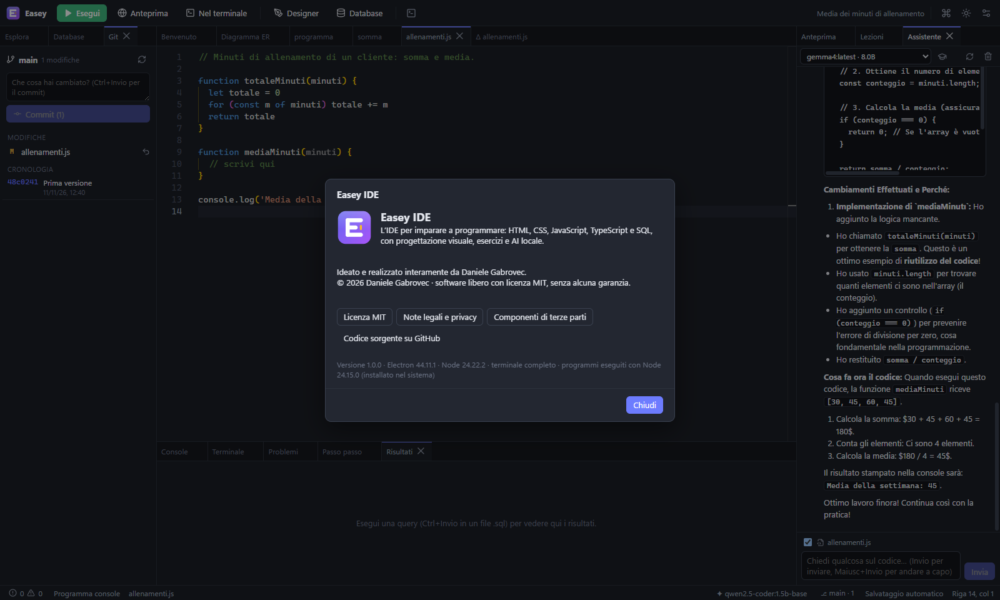

---

## English summary

**Easey IDE** is a free, open-source (MIT) desktop IDE for Windows designed for **learning to code**:
HTML, CSS, JavaScript, TypeScript, Python and SQL. It combines a Monaco-based editor with live preview,
a real terminal, a step-by-step debugger with variables and call stack, a Canva/Wix-style visual page
designer, Blockly blocks and node-based visual programming, diagrams that turn into code, an SQL lab
with SQLite and embedded PostgreSQL, Git integration, project export, lessons with **automatically
checked exercises**, and a **Quick code** mode (Ctrl+Shift+Q) to try JavaScript, TypeScript,
Python (bundled Pyodide, no install), SQL or HTML without a project, with results shown next to each line,
infinite loops stopped, four AI assistance levels and a collection of saved snippets. Its AI assistant runs **entirely on your machine** through Ollama or any
OpenAI-compatible local server (LM Studio, llama.cpp, vLLM): inline completion, contextual chat,
code explanations and fixes, natural-language SQL and a tutor mode that gives hints instead of answers.
The UI is in Italian (English translation included).

Designed and built entirely by **Daniele Gabrovec** · © 2026 · [MIT License](LICENSE).
